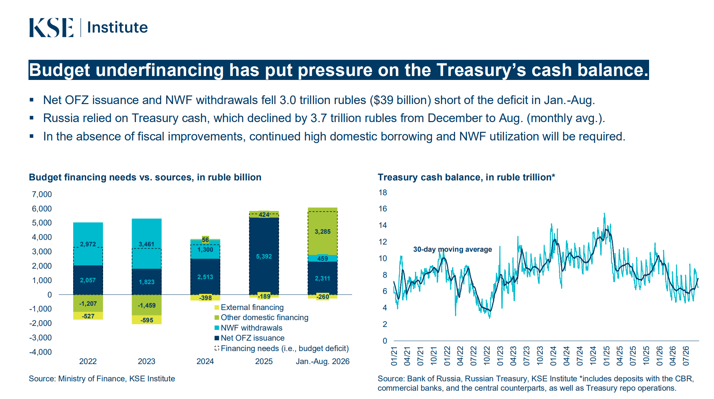
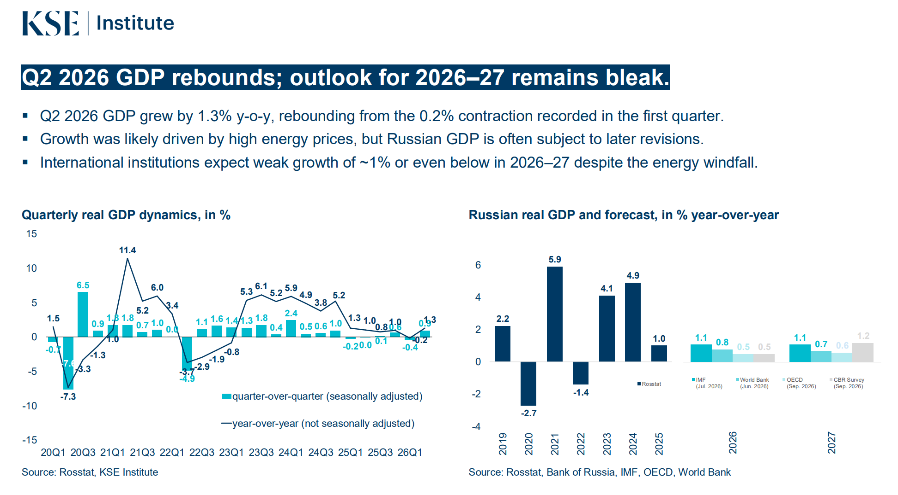

It is important that we continue to support Ukraine and to sanction Russia. Russia's economic outlook seems worse now than in the first years of war. The  economic attrition should eventually make Russia to end its aggression. Some graphs below.

Russia's budget deficit has been high lately. It has managed to increase its revenue a lot through e.g. tax increases, but its military spending has also risen a lot. Oil revenues have been hit by disruptions and sanctions, but this year's high oil prices have also boosted them. 

(budjettiosat ja tasapaino, öljyn hinta)

The deficit is funded mostly by domestic debt/bonds (OFZs), especially since liquid funds in National Welfare Fund have been greatly reduced, as have the state deposits in commercial banks. Russia is also cut away from most international financing due to sanctions. 

( kse funding sources, fixed coupon + floating coupoin, kse domestic ofz)

3. 
Russia has to pay a massive interest for its debt, mainly to its commercial banks. Russia's 10 year bond yield for its fixed coupoon debt is very high, compared to other countries. 

(10 vuoden bond vertailu, eri aikavälien bondit)

A big share of the domestic debt is also in floating coupon bonds, whose variable cost is determined by the central bank key rate + a premium. 

Based on ROISfix index, the markets expect the key rates to stay high over the next two years as well. 

(ohjauskorko ´+ roisfix)

Russia's debt level is still low by international standards, but due to its rate of increase and especially Russia's high bond yields, its debt servicing costs (interest payments of the debt) are very high and increasing. 

(budget spending plan + debt service cost, in trillions)

They could soon amount to over 10% of budget spending and 2% of GDP, and the Finance Ministry's plan may even be optimistic in terms of spending and key rate decisions. 

(debt service cost, %)

Russia can further increase its taxes to combat this, but in worsened economic situation, this has greater chance to trigger cascading negative effects to the economy. 

Some bad outlooks on Russia's economy: 
- Weak economic growth and industrial production
- Business and consumer confidence down

(kse gdp, trading economics industrial, trading economics business and consumer)

More:
- Labor shortages and high real wage strain corporations
- corporate profits trending down after the initial war economy stimulus.
- Corporate bond yields and loan rates remain elevated. 

(kse kuva, corporate profits, bond yields, key rate, corporate rates)

It is hard to tell how far the economy is from a hard accelecration to a negative spiral, but the direction is there. 

A good monthly overview to follow on Russia's economy: https://sanctions.kse.ua/en/sanctions-analytics/

Oil and gas has a decreasing role in public finance but a decrease in global oil prices would have an important role in worsening Russia's situation. Good source to follow regarding Russia's oil and gas revenues: 

Russia is still increasing its military spending. We cannot just wait for its economic demise but also continue to support Ukraine. For individuals, this is a good place to do it: 

https://tradingeconomics.com/russia/industrial-production
https://tradingeconomics.com/russia/corporate-profits
https://tradingeconomics.com/russia/business-confidence

Venäjä nostanut veroja. 

Sources: 

https://tradingeconomics.com/russia/business-confidence

https://tradingeconomics.com/russia/consumer-confidence
