It is important that we continue to support Ukraine and to sanction Russia. Russia's economy seems worse now than in the first years of the war, and increased pressure on it could therefore be very efficient in ending its aggression.

Some graphs below.

(Note: I'm not an expert on the field)

Russia's budget deficit has been high lately. It has managed to increase its revenue a lot through e.g. tax increases, but its military spending has also increased significantly. Oil revenues have been hit by disruptions and sanctions, but recent high oil prices have also boosted them.

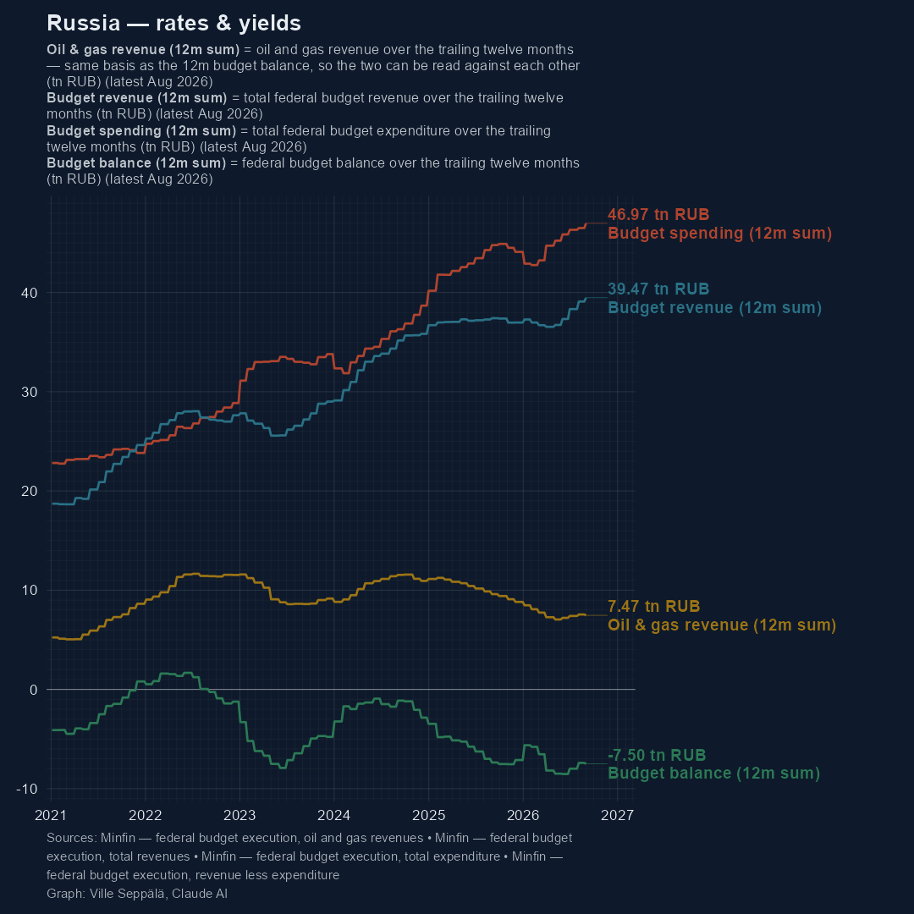

The deficit is funded mostly by domestic debt/bonds (OFZs), especially since liquid funds in National Welfare Fund have been greatly reduced, as have the state deposits in commercial banks. Russia is also cut away from most international financing due to sanctions.

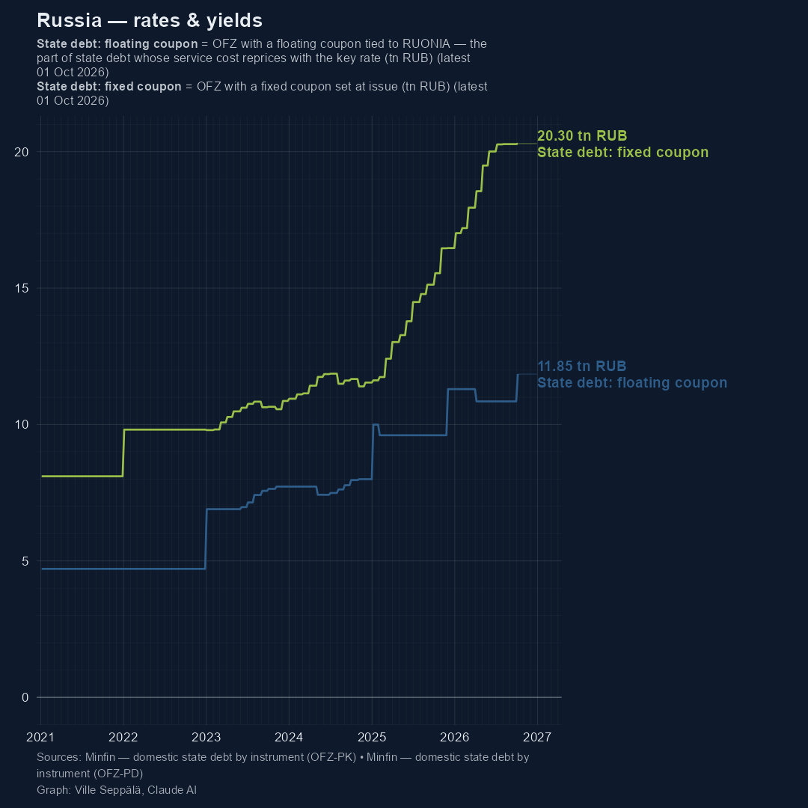

Russia has to pay a massive interest for its debt, mainly to its commercial banks. Russia's 10 year bond yield for its fixed coupoon debt is very high, compared to other countries.

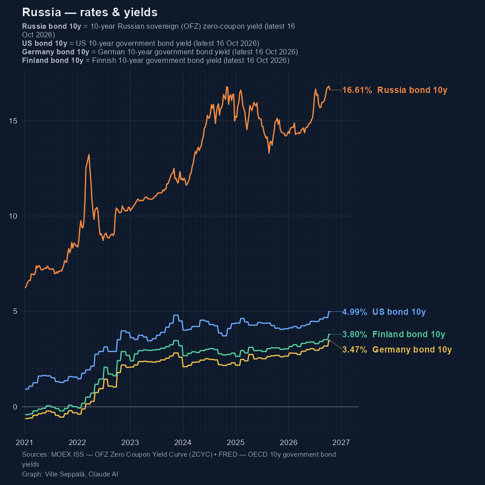

A big share of the domestic debt is also in floating coupon bonds, whose variable cost is determined by the central bank's key rate + a premium.

Based on ROISfix index, the markets expect the key rates to stay high over the next two years as well.

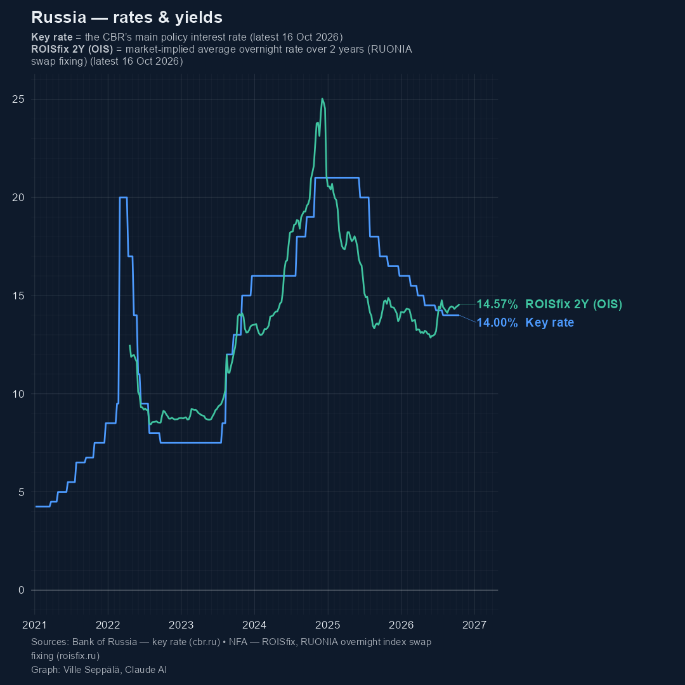

Russia's debt level is still low by international standards, but due to its rate of increase and especially Russia's high bond yields, its debt servicing costs (interest payments of the debt) are very high and increasing.

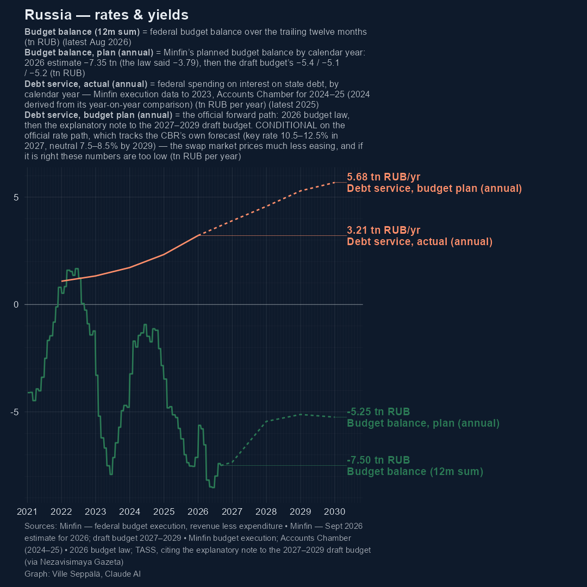

They could soon amount to over 10% of budget spending and 2% of GDP, and the Finance Ministry's plan may even be optimistic in terms of spending and key rate decisions.

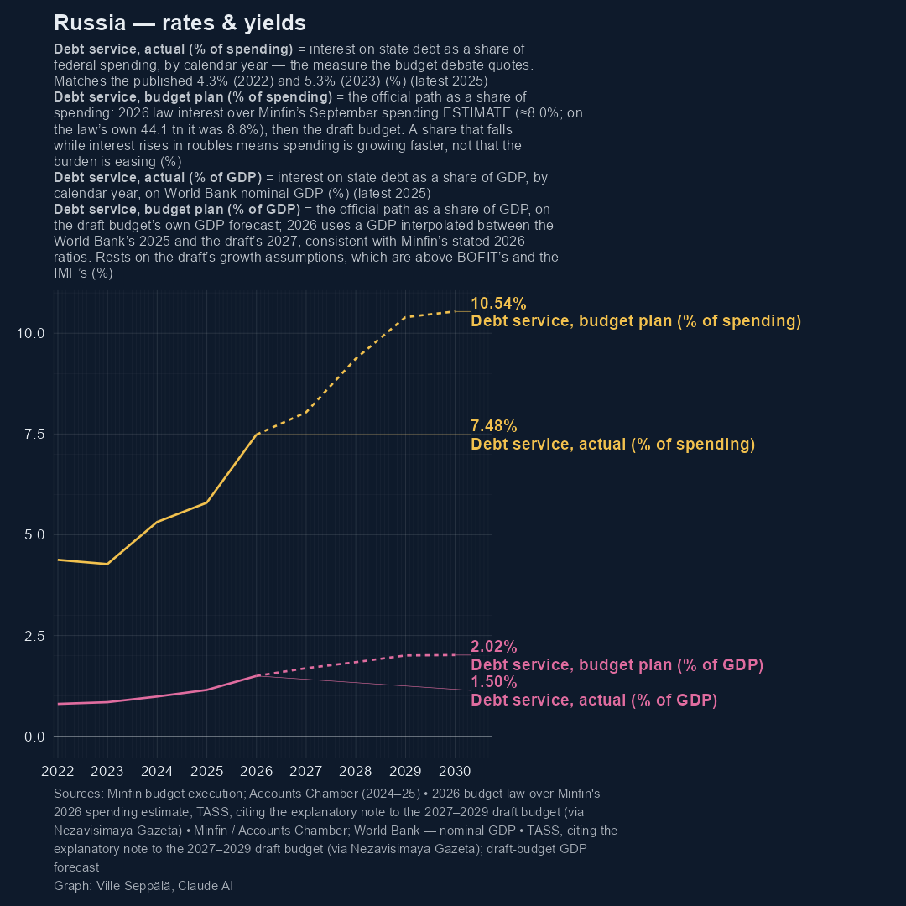

Russia can further increase its taxes to combat this, but in worsened economic situation, this has greater chance to trigger cascading negative effects to the economy.

Some indicators on Russia's economy:

-   Weak economic growth and industrial production

-   Business and consumer confidence down

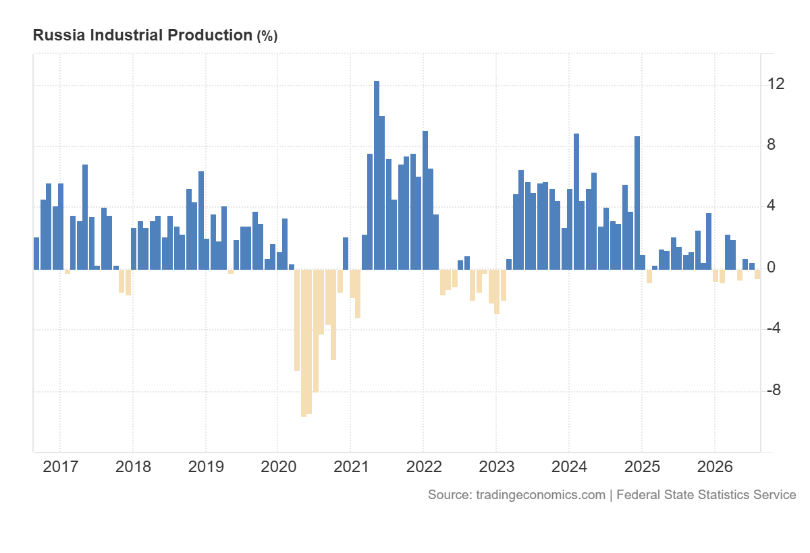

.png)

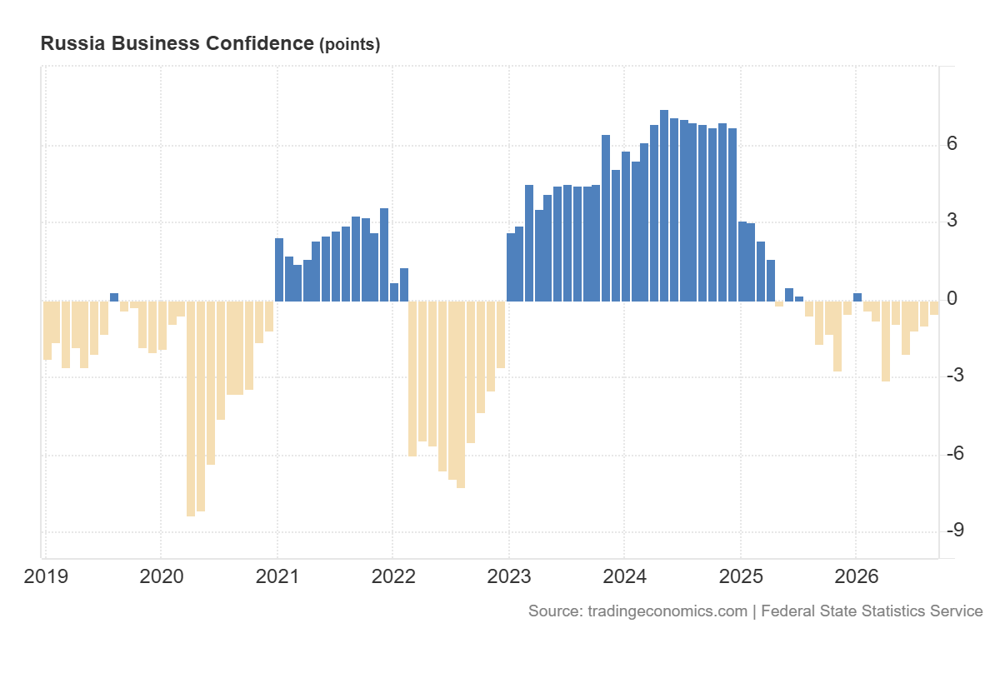

More:

-   Labor shortages and high real wage strain corporations

-   Corporate profits trending down after the initial war economy stimulus.

-   Corporate bond yields and loan rates remain elevated.

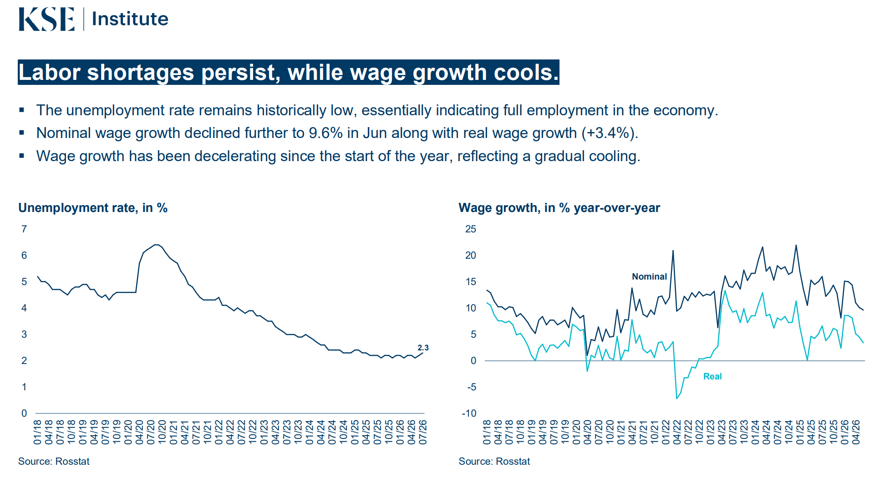

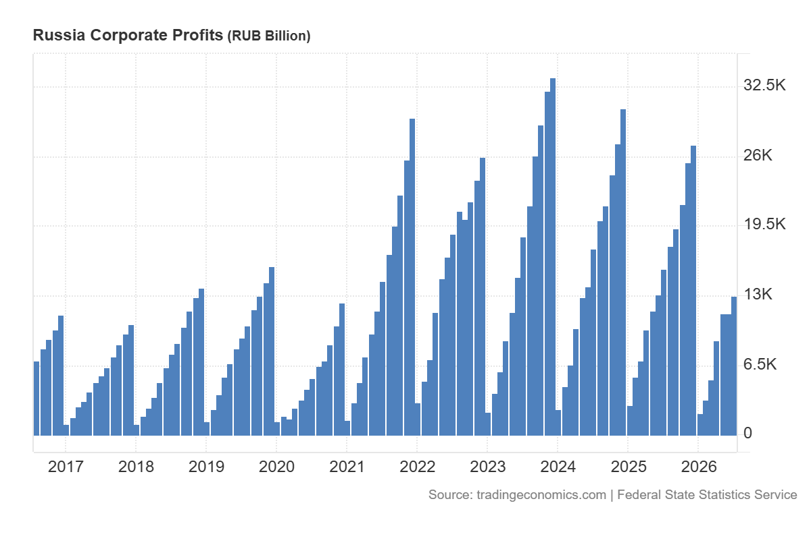

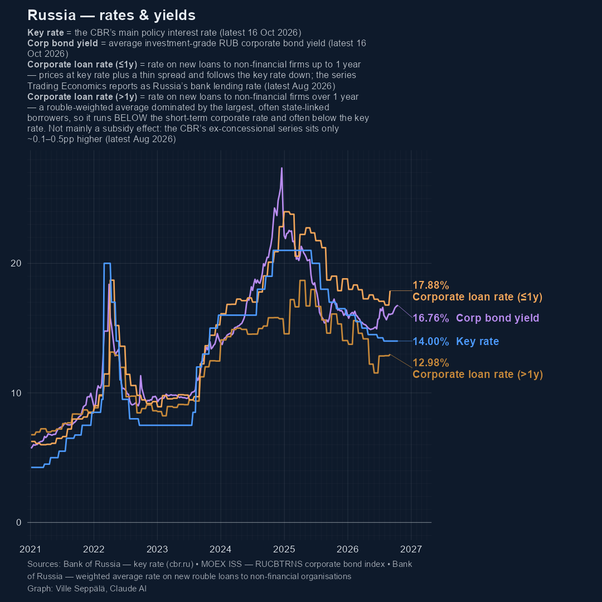

However, Russia's oil revenues might rise a lot, based on CREA estimates: https://energyandcleanair.org/russia-sanction-tracker/

Also, private sector demand has remained high, and the trade balance is very positive.

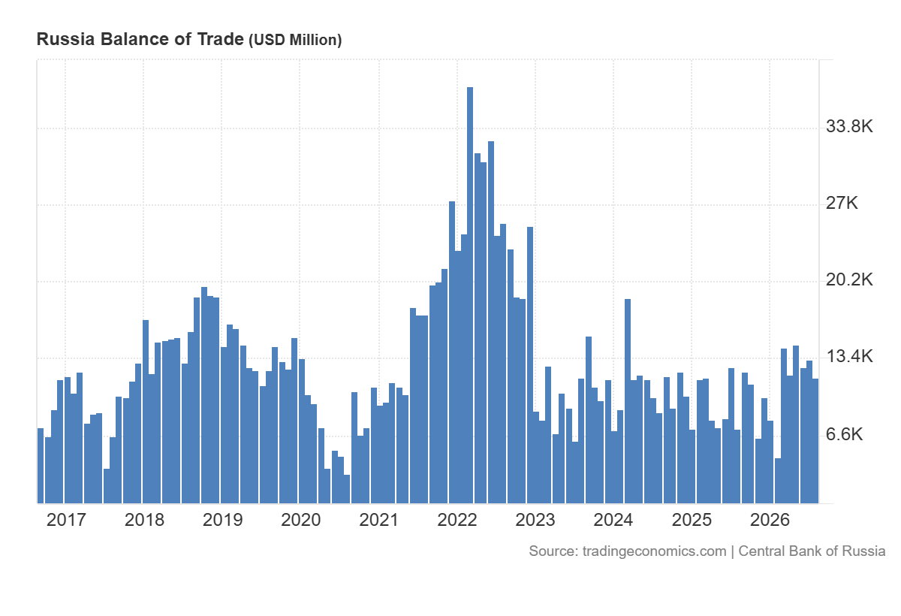

Russia is also still sincreasing its military spending, which is both dangerous to Ukraine in on itself and a show of economic confidence, at least in the short term. Other spending is being cut at the same time. https://www.reuters.com/world/russia-raises-2027-military-spending-by-27-budget-documents-show-2026-09-28/

All in all, it is hard to tell how far the economy is from a hard accelecration to a negative spiral, but the direction is there, and some changes be swift.

A good monthly overview to follow on Russia's economy: https://sanctions.kse.ua/en/sanctions-analytics/

We cannot just wait for Russia's economic demise but also to hasten it with sanctions. We must also continue to support Ukraine. For individuals, this is a good place to donate directly: https://u24.gov.ua/

External image sources used:

KSE images from September 2026 edition: https://sanctions.kse.ua/en/sanctions-analytics/

Trading Economics: https://tradingeconomics.com/